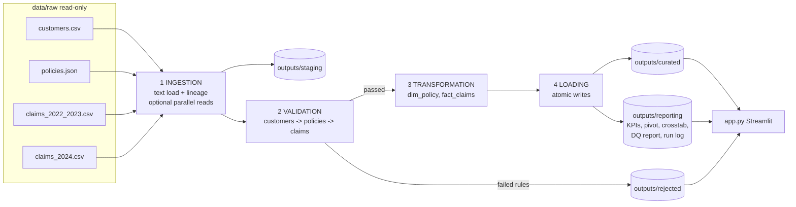

# Architecture - InsureData Pipeline

## Components
`ingestion.py`, `validation.py`, `transformations.py`, `analytics.py`, `storage.py`, `pipeline.py`, `utils.py`; `run.py` (CLI); `app.py` (UI).

## Data flow and keys
customers (PK `customer_id`) <- policies (PK `policy_id`, FK `customer_id`) <- claims (PK `claim_id`, FK `policy_id`). Joins: `policies.customer_id -> customers.customer_id` and `claims.policy_id -> dim_policy.policy_id`, both validated as many-to-one. Unmatched references are rejected before joining, so joins cannot drop or multiply rows.

## Input / output contracts
Inputs and column rules: [docs/data_dictionary.md](docs/data_dictionary.md). Outputs: `staging/*_raw`, `curated/{dim_customer,dim_policy,fact_claims}`, `rejected/*_rejected` (+`reject_reasons`), `reporting/{metrics_by_policy_type, metrics_by_region, monthly_claims, pivot_incurred_type_by_region, crosstab_type_by_status}` (csv/parquet), `kpis.json`, `data_quality_report.json`, `pipeline_summary.json`, `pipeline_runs.jsonl`.

## Error handling
Structural problems (missing file/column, unreadable file, oversize) raise `IngestionError` -> CLI exit code 2 / UI message. Data problems become rejected rows. A built-in assertion fails the run if input != curated + rejected.

## Storage design
Fixed filenames; temp-file + `os.replace`; only the run log appends. Parquet written when pyarrow is available.

## Scalability considerations (design notes, not implemented)
Cloud: raw in object storage (S3/ADLS/GCS), stages as Spark/dbt/SQL jobs writing partitioned Parquet/Delta, same zones, rejected table retained. Larger DB: load curated tables into Postgres/warehouse with PK/FK constraints mirroring the rules. Orchestration: Airflow/Prefect tasks per stage with retries and alerts (`docs/scheduling.md`).
