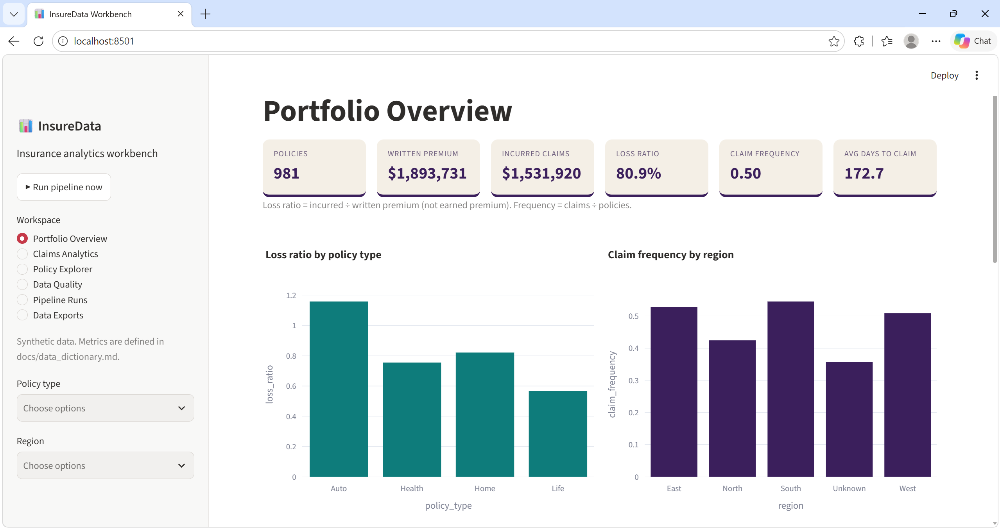
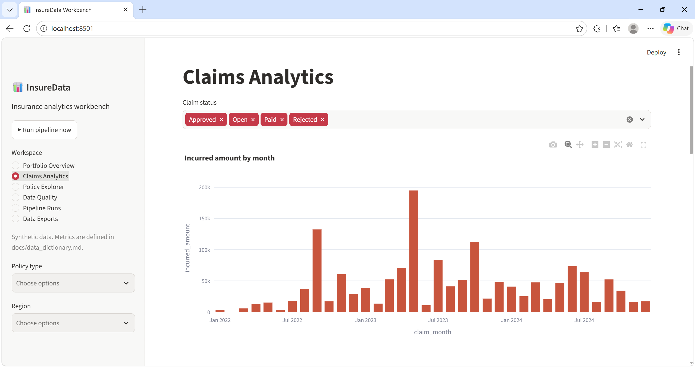
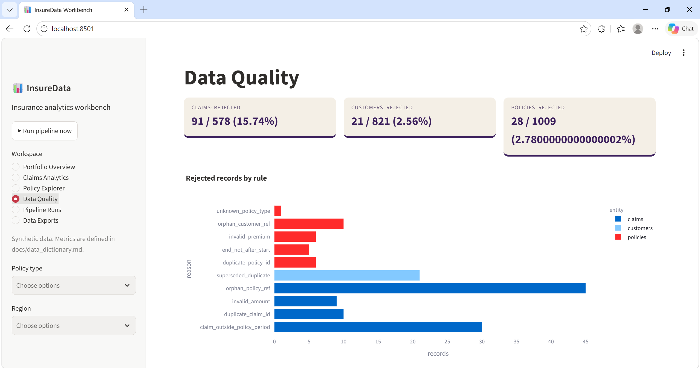
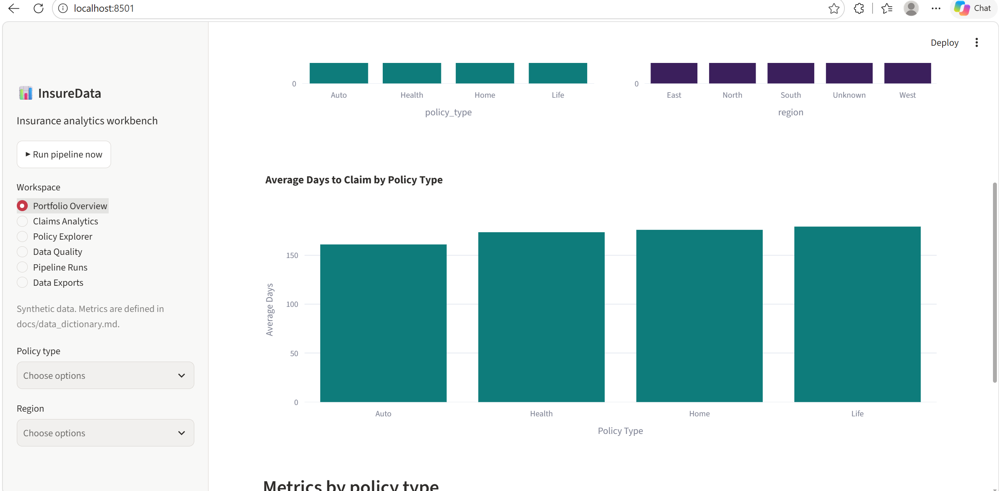

# InsureData Pipeline - Insurance Data Engineering and Analytics Workbench

A reproducible, local ETL pipeline that turns messy **synthetic** customer, policy and claims files into curated analytical tables, plus a Streamlit analytics workbench.

> **All data is synthetic** (seed 2024) and no real insurer, customer or benchmark is represented. Metric values have no industry meaning. This is a portfolio/teaching project, not a production system.

## Business problem
An analytics team receives customer, policy and claims data from different systems with inconsistent values, duplicates, invalid dates, unmatched references and rule violations. They need trusted datasets, explicit rejected-record files, precise metric definitions and repeatable runs. See [PROBLEM_STATEMENT.md](PROBLEM_STATEMENT.md).

## Features
- Explicit stages: **ingestion -> validation -> transformation -> loading**, with per-stage timing.
- Inputs: CSV, JSON (Excel/Parquet readers also supported and Excel is unit-tested).
- Zones in `outputs/`: `staging/`, `curated/`, `rejected/`, `reporting/`.
- Standardized dates, IDs, categories, money fields; documented rules per entity.
- Referential integrity: customers -> policies -> claims; orphan references rejected with reasons.
- Claim-vs-policy-period business rule; coverage-limit flag with capped incurred amount.
- Metrics: claim frequency, incurred amount, loss ratio, average claim, approval rate; by policy type and region; monthly trend; pivot (type x region) and crosstab (type x status).
- Data-quality report, pipeline summary, run log; CSV + Parquet (when `pyarrow` is installed).
- Idempotent reruns; optional bounded parallel ingestion of the two claims files.
- Dashboard: Portfolio Overview, Claims Analytics, Policy Explorer, Data Quality, Pipeline Runs, Data Exports.

-#Updated:-
- Configurable maximum policy term (default: 2 calendar years); longer policies are rejected with explicit reasons.
- Average days to claim KPI, measuring the average time between policy start and claim date, including valid claims with Rejected status.

## Technology stack
Python 3.11+, **Pandas**, **NumPy**, **PyArrow** (Parquet), **openpyxl** (Excel input), **Streamlit**, **Plotly**, pytest/unittest, `concurrent.futures`, `logging`, `pathlib`. No Airflow/Spark/cloud needed; scaling ideas are documented, not implemented.

## Architecture overview
See [ARCHITECTURE.md](ARCHITECTURE.md) for the diagram. Scheduling example and cloud-scaling notes: [docs/scheduling.md](docs/scheduling.md).


## Dashboard Screenshots

### Portfolio Overview


### Claims Analytics


### Data Quality


### Average Days to Claim by Policy Type



## Quick start (first 15 minutes)

**Prerequisites:** Python 3.11 or newer (`python --version`), `pip`, a terminal, ~300 MB disk. No internet is needed *after* installing dependencies. No accounts, API keys or paid services.

**1. Open the project folder** (the folder that contains `run.py` and `app.py`):

```bash
cd Python_Interview_Portfolio_Projects/project_3_insuredatapipeline
```

**2. Create and activate a virtual environment**

| OS | Commands |
|---|---|
| Windows (PowerShell) | `python -m venv .venv` then `.venv\Scripts\Activate.ps1` |
| Windows (cmd) | `python -m venv .venv` then `.venv\Scripts\activate.bat` |
| macOS / Linux | `python3 -m venv .venv` then `source .venv/bin/activate` |

If PowerShell blocks activation: `Set-ExecutionPolicy -Scope Process -ExecutionPolicy Bypass` and retry.

**3. Install dependencies** (run inside the activated environment, inside this folder):

```bash
pip install -r requirements-dev.txt
```

**4. Sample data:** already included in `data/`. To regenerate it (same seed => same files): `python scripts/generate_sample_data.py`

**5. Run the pipeline:**

```bash
python run.py --parallel
```

**Expected first result:** four stage log lines (ingestion, validation, transformation, loading) and `Run <12-hex-id> OK in ~0.2s`, then per-entity counts - customers in=821 curated=800 rejected=21; policies in=1009 curated=981 rejected=28; claims in=578 curated=487 rejected=91 - and a KPI block (981 policies, 487 claims, loss_ratio 0.8089, claim_frequency 0.4964). Running it again prints `rerun of identical input: True` with identical data files.

**6. Launch the interface:**

```bash
streamlit run app.py
```

Streamlit prints a local URL (normally http://localhost:8501) and opens your browser. Use **Run pipeline now** in the sidebar if the outputs folder is empty; the filters in the sidebar apply to every page.

**7. Run the tests:**

```bash
python -m pytest -q          # or, without pytest installed:  python -m unittest discover -s tests
```

**8. Stop the app:** press `Ctrl+C` in the terminal that runs Streamlit. Deactivate the environment with `deactivate`.

**Common fixes:** `ModuleNotFoundError` -> the environment is not activated or step 3 was skipped. Port busy -> `streamlit run app.py --server.port 8502`. More in [docs/troubleshooting.md](docs/troubleshooting.md).


Useful CLI options: `python run.py --parallel` (concurrent claims-file reads), `--no-parquet`, `--input DIR`, `--output DIR`, `--config FILE`.

## Sample data and intentional errors
`data/raw/customers.csv` (821 rows), `policies.json` (1,009), `claims_2022_2023.csv` + `claims_2024.csv` (578 together). Injected problems: duplicate customers (newer and older versions), lowercase/space IDs, invalid/future DOBs, region typos, policy-type aliases (`Motor`, `AUTO`, `property`...), unknown type, `$`-formatted/negative/missing premiums, end date = start date, duplicate policy rows, unknown customer references, unknown policy references on claims, claims outside the policy period, bad amounts, status aliases, 8 claims above coverage limits, duplicate claim IDs. Full list: [docs/data_dictionary.md](docs/data_dictionary.md).

## Expected outputs (default run)
customers 821 -> 800 curated / 21 rejected; policies 1,009 -> 981 / 28; claims 578 -> 487 / 91 (45 orphan policy refs, 30 outside policy period, 10 duplicates, 9 invalid amounts). KPIs: loss ratio 0.8089, claim frequency 0.4964, approval rate 0.7677, KPIs: loss ratio 0.8089, claim frequency 0.4964,approval rate 0.7677, average days to claim 172.66. Copies: `docs/expected_output/`.

## Configuration
`config/pipeline.json`: as-of date, date formats, maximum policy term
(default: 2 calendar years), maximum age, policy-type and claim-status
maps, valid regions, claims file names and input size guard.
No secrets.

## Testing
```bash
python -m pytest -q        # or: python -m unittest discover -s tests
```
Verified with `python -m unittest discover -s tests`: **26 tests, OK** (Python 3.12.3, pandas 3.0.2, openpyxl 3.1.5). pytest and PyArrow were not installable in the build environment (no network): run pytest on your machine and record your result; Parquet writing was not exercised.

## What I changed and why

The following enhancements were added to extend the original InsureData Pipeline:

1. **Maximum policy-term validation:** Added a configurable `max_policy_term_years` setting (default: 2) to reject policies whose duration exceeds two calendar years. Added tests for policies exceeding the limit and policies ending exactly at the limit.

2. **Average days to claim:** Added `avg_days_to_claim` to the portfolio KPIs. It measures the average number of days between policy start and claim date across valid claims, including claims with a Rejected status.

3. **Dashboard enhancement:** Added an Average Days to Claim KPI card and a chart comparing average days to claim across policy types.


## Limitations and future work
Local files only; whole files in memory (100 MB guard); frequency and loss ratio ignore exposure/earned premium; rejection rules are illustrative, not actuarial; claims ending after the as-of date are not specially handled. The dashboard was tested locally using Streamlit.
Future: incremental loads, partitioned Parquet, orchestration, exposure-based metrics.

## Attribution
Synthetic data created for teaching. Libraries retain their own licenses. See `LICENSE`.
